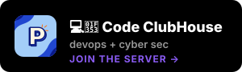
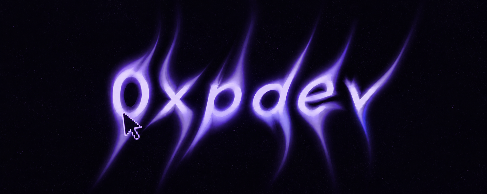

<!-- HEADER -->

  

  

<!-- CONNECT -->

 

<!-- TECH -->
<h3 align="center">⚡ Tech</h3>

  

 

<!-- GITHUB STATS -->
<h3 align="center">📊 GitHub Stats</h3>

  

  
  

  

 

<!-- ACTIVITY -->
<h3 align="center">📈 Contribution Activity</h3>

  

  

 

<!-- COMMUNITY -->
<h3 align="center">🤝 Community</h3>

&nbsp;&nbsp;

 

<!-- CONTACT / SUPPORT -->

**Open to collaborations, freelance work, and interesting ideas.**
 
If you're building something ambitious — let's talk.

  

&nbsp;

&nbsp;

 

  

